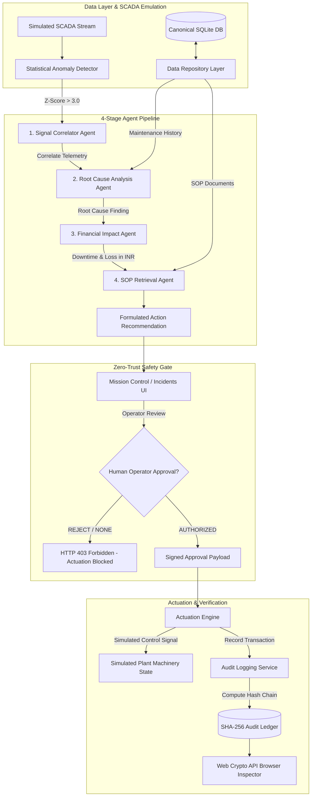

# Industrial CrisisOps

## Agentic Industrial Incident Investigation & Autonomous Recovery Platform

[](https://www.python.org/)
[](https://fastapi.tiangolo.com/)
[](https://reactjs.org/)
[](https://www.typescriptlang.org/)
[](https://vitejs.dev/)
[](https://www.sqlite.org/)
[](backend/tests/)
[](LICENSE)

CrisisOps is an India-focused, agentic AI platform engineered for industrial incident investigation, root-cause correlation, and policy-controlled autonomous recovery. Designed specifically for plant operators, maintenance engineers, and shift supervisors, CrisisOps transforms raw industrial telemetry anomalies into explainable diagnostics, quantitative financial exposure estimates (in INR ₹), and standard operating procedure (SOP) recovery plans — enforced with strict, non-bypassable human-in-the-loop safety gates and tamper-evident SHA-256 cryptographic audit chaining.

> **Operational Scope & Engineering Positioning**: CrisisOps operates in a simulated industrial environment designed to reflect modern automotive plant operations. Actuation controls interface with simulated PLC registers and equipment states. All high-risk state changes require explicit human approval.

---

## 1. Problem Statement

In 24/7 continuous industrial manufacturing facilities — such as high-precision automotive component machining lines — equipment anomalies present critical operational bottlenecks:

1. **Alarm Fatigue & Cognitive Overload**: SCADA and IoT sensor arrays broadcast thousands of data points per minute. During an anomaly, operators are inundated with raw threshold alarms without context, statistical significance, or severity hierarchy.
2. **Siloed Diagnostics & Slow Root Cause Discovery**: Telemetry breaches are isolated from maintenance records, equipment overhaul histories, and operating limits. Determining why a pump bearing or CNC spindle is overheating requires manual cross-system log searching.
3. **Unquantified Financial Exposure**: Plant leadership and shift supervisors lack real-time visibility into the rupee cost of active downtime, capacity reduction, scrap generation, and labor overtime during an unfolding incident.
4. **Static, Paper-Based SOPs**: Standard Operating Procedures remain trapped in physical binders or static PDFs, causing delays in executing time-critical containment procedures.
5. **Catastrophic Actuation Risk**: Black-box autonomous AI actuation presents unacceptable safety hazards if permitted to execute unvalidated speed or throttle adjustments on live machinery.
6. **Unverifiable Compliance Records**: Post-incident auditing frequently suffers from incomplete or retroactively altered log files lacking mathematical proof of human authorization.

---

## 2. Proposed Solution

Industrial CrisisOps addresses these challenges with a deterministic, multi-agent operational platform:

- **Automated Anomaly Detection**: Evaluates incoming telemetry streams against rolling statistical baselines using standard deviation Z-scores ($|Z| \ge 3.0$).
- **Explainable Multi-Agent Pipeline**: Coordinates four specialized agents (Signal Correlation, Root Cause Analysis, Financial Impact Assessment, and SOP Retrieval) to synthesize raw signals into actionable intelligence.
- **India-Focused Plant Financial Modeling**: Computes downtime losses, capacity reductions, and repair costs denominated in Indian Rupees (₹ INR) for domestic manufacturing contexts.
- **Zero-Trust Human Approval Invariant**: Enforces a strict server-side policy (`HTTP 403 Forbidden`) prohibiting containment actuation without cryptographic recording of human authorization.
- **Cryptographic SHA-256 Audit Ledger**: Chains every telemetry breach, agent deduction, human authorization, and simulated actuation in a tamper-evident hash chain verifiable directly in the browser via the Web Crypto API.
- **Dedicated 10-Module Operations Suite**: Provides distinct, role-tailored workspaces for Mission Control, Live SCADA Monitoring, Incident Investigation, Fleet Registry, Predictive Maintenance, SOP Library, Plant Analytics, Audit History, and System Configuration.

---

## 3. Key Features

- **Real-Time Fleet Telemetry (Simulated)**: Monitored view of 10 automotive line assets across Chakan MIDC, Pune with temperature, vibration, RPM, and pressure readings.
- **Statistical Anomaly Classification**: Highlights anomalies using rolling Z-scores ($Z = +3.83$ critical breach on bearing vibration).
- **Automated Work Order Correlation**: Cross-references telemetry spikes with overdue maintenance logs (e.g., MNT-882 bearing replacement overdue by 60 days).
- **Deterministic SOP Retrieval**: Keyword and TF-IDF matching indexes standard operating procedures (e.g., SOP-M204-BEARING) to generate step-by-step mitigation plans.
- **Quantitative INR Financial Risk Engine**: Line-item financial impact breakdown modeling production loss per hour, scrap value, and emergency maintenance costs.
- **Server-Side Safety Invariant**: Zero-trust architecture rejecting unauthorized actuation with `HTTP 403 Forbidden`.
- **Browser-Native Web Crypto Hash Inspector**: Recalculates SHA-256 hash chains client-side to verify ledger integrity with zero server dependency.
- **7-Act Presentation & Hotkey Controller**: Guided 3-minute hackathon evaluation mode with keyboard hotkeys (`1` through `7`) and interactive walkthroughs.

---

## 4. System Architecture



---

## 5. Technology Stack

### Backend
- **Language**: Python 3.10+ (tested on Python 3.14)
- **Web Framework**: FastAPI 0.115.0 (ASGI high-concurrency framework)
- **Server**: Uvicorn 0.34.0 (lightning-fast ASGI web server)
- **Data Layer**: SQLAlchemy 2.0.38 + SQLite 3 (deterministic edge storage)
- **Validation**: Pydantic v2 (strict request/response typing)
- **Testing**: Pytest 8.3.4 (41 unit, integration, and security tests)

### Frontend
- **Framework**: React 18.3.1
- **Language**: TypeScript 5.5.3 (strict typing enabled)
- **Build Tool**: Vite 5.4.21 (ESM fast bundle compilation)
- **Styling**: Tailwind CSS 3.4.17 + Industrial Dark High-Contrast Theme
- **Icons**: Lucide React 0.469.0
- **Charts**: Recharts 2.15.0
- **Security / Cryptography**: W3C Web Crypto API (`window.crypto.subtle`)

---

## 6. Agentic AI Workflow

The CrisisOps agent runtime executes a closed-loop investigation and recovery cycle:

```
                      [ Goal Formulation ]
                                ↓
                      [ Telemetry Stream ]
                                ↓
                     [ Anomaly Detection ]
                      (Z-Score Threshold)
                                ↓
                   [ Evidence Accumulation ]
               (Telemetry + Maintenance Logs)
                                ↓
                   [ Multi-Agent Synthesis ]
       ┌─────────────────┬──────────────────┬─────────────────┐
       ↓                 ↓                  ↓                 ↓
 [Signal Correlator] [Root Cause]    [Impact in INR]    [SOP Match]
       └─────────────────┴──────────────────┴─────────────────┘
                                ↓
                 [ Human Authorization Gate ]
                                ↓
                 [ Policy-Controlled Actuation ]
                                ↓
                   [ Quantitative Outcome ]
                    (Vibration / Temp Drop)
                                ↓
                 [ SHA-256 Audit Commitment ]
```

1. **Observe**: Ingests rolling multi-variate telemetry (temperature, vibration, RPM, pressure).
2. **Evaluate Evidence**: Evaluates departures from nominal operating envelopes.
3. **Correlate**: Links anomalous physical signatures with equipment overhaul schedules and historical failure patterns.
4. **Quantify**: Calculates economic consequences of unmitigated failure in Indian Rupees.
5. **Recommend**: Matches equipment tags and failure modes against standard operating procedures.
6. **Gate**: Halts autonomous execution; demands human operator authorization.
7. **Actuate & Verify**: Modifies simulated machinery operating parameters, verifies metric recovery, and seals the event to an immutable cryptographic audit ledger.

---

## 7. Industrial Use Case: Pune Automotive Manufacturing Plant

- **Facility**: High-Precision Automotive Powertrain & Transmission Plant
- **Location**: Chakan MIDC Industrial Area, Pune, Maharashtra, India
- **Operating Regime**: 24/7 continuous 3-shift production schedule
- **Target Assets**: 10 critical machines across machining, welding, casting, and finishing bays.
- **Primary Incident (`INC-M204-001`)**:
  - **Asset**: PMP-204 Centrifugal Coolant Pump (`M-204`)
  - **Location**: Line B - Cooling Water Circulation Bay
  - **Function**: Supplies cooling water to high-speed CNC spindle heads.
  - **Failure Event**: Drive-end bearing thermal breakdown accompanied by harmonic vibration breach ($7.82\text{ mm/s}$ vs $4.50\text{ mm/s}$ safety threshold).
  - **Root Cause**: Overdue maintenance record `MNT-882` (bearing replacement exceeded by 60 days).
  - **Mitigation Procedure**: `SOP-M204-BEARING` (throttle pump to 25% capacity, spin up standby pump PMP-102, dispatch emergency mechanical team).

---

## 8. Sample Machine & Incident Dataset

CrisisOps ships with 10 pre-configured, domain-accurate automotive manufacturing assets:

| Machine ID | Equipment Name | Category | Criticality | Nominal Baseline | Alert Threshold | Operational Role |
| :--- | :--- | :--- | :--- | :--- | :--- | :--- |
| **M-204** | PMP-204 Centrifugal Coolant Pump | Centrifugal Pump | CRITICAL | $1.80\text{ mm/s}, 65.0^\circ\text{C}$ | $4.50\text{ mm/s}, 75.0^\circ\text{C}$ | Spindle cooling water circulation |
| **M-101** | CNC-101 5-Axis Milling Centre | CNC Machining | HIGH | $0.80\text{ mm/s}, 52.0^\circ\text{C}$ | $2.50\text{ mm/s}, 68.0^\circ\text{C}$ | Engine cylinder block finishing |
| **M-102** | CNC-102 High-Speed Turning Lathe | CNC Turning | HIGH | $0.95\text{ mm/s}, 48.0^\circ\text{C}$ | $2.80\text{ mm/s}, 65.0^\circ\text{C}$ | Transmission gear shaft turning |
| **M-103** | CNC-103 Horizontal Machining | CNC Machining | MEDIUM | $1.10\text{ mm/s}, 55.0^\circ\text{C}$ | $3.00\text{ mm/s}, 70.0^\circ\text{C}$ | Transmission housing milling |
| **M-201** | PMP-101 Primary Hydraulic Pump | Hydraulic Pump | CRITICAL | $1.50\text{ mm/s}, 58.0^\circ\text{C}$ | $4.00\text{ mm/s}, 72.0^\circ\text{C}$ | 200-bar stamping press hydraulics |
| **M-301** | CMP-301 Rotary Screw Air Compressor | Air Compressor | HIGH | $1.60\text{ mm/s}, 68.0^\circ\text{C}$ | $4.20\text{ mm/s}, 82.0^\circ\text{C}$ | Shop-floor pneumatic tools supply |
| **M-302** | CMP-302 Reciprocating Gas Compressor | Gas Compressor | HIGH | $2.10\text{ mm/s}, 72.0^\circ\text{C}$ | $4.80\text{ mm/s}, 85.0^\circ\text{C}$ | Nitrogen blanket purge system |
| **M-401** | TUR-401 Auxiliary Steam Turbine | Co-Gen Turbine | CRITICAL | $1.20\text{ mm/s}, 78.0^\circ\text{C}$ | $3.50\text{ mm/s}, 92.0^\circ\text{C}$ | In-plant waste heat co-generation |
| **M-501** | ROB-501 Robotic Spot Welding Cell | Industrial Robot | HIGH | $0.50\text{ mm/s}, 42.0^\circ\text{C}$ | $2.00\text{ mm/s}, 58.0^\circ\text{C}$ | BIW chassis unibody spot welding |
| **M-601** | CON-601 Heavy Roller Conveyor | Material Handling | MEDIUM | $1.40\text{ mm/s}, 45.0^\circ\text{C}$ | $3.80\text{ mm/s}, 62.0^\circ\text{C}$ | Machining-to-assembly pallet line |

---

## 9. Human Approval & Zero-Trust Safety Architecture

CrisisOps enforces an unbypassable server-side security constraint inside [`backend/app/services/actuation_engine.py`](file:///d:/Vajra/backend/app/services/actuation_engine.py).

```python
# Actuation Security Invariant: backend/app/services/actuation_engine.py
recommendations = self.db.query(ActionRecommendation).filter(
    ActionRecommendation.incident_id == incident_id
).all()

# SERVER-SIDE INVARIANT: Actuation REQUIRES explicit human approval
if not recommendations or not any(r.human_approved for r in recommendations):
    raise HTTPException(
        status_code=403, 
        detail="ACTUATION FORBIDDEN: Human operator approval is required before containment execution."
    )
```

- Any attempt to invoke `POST /api/incidents/{incident_id}/actuate` without an approved recommendation returns **`403 Forbidden`**.
- Approvals record the operator's badge ID, role, and timestamp, permanently logged to the immutable audit ledger.

---

## 10. Cryptographic SHA-256 Audit Verification

Every state mutation, agent finding, human authorization, and actuation command is committed to an append-only cryptographic hash chain.

### Hash Chaining Formula
For any audit entry $n$:

$$H_n = \text{SHA256}\left( \text{log\_id}_n \parallel \text{timestamp}_n \parallel \text{actor\_type}_n \parallel \text{actor\_id}_n \parallel \text{action\_type}_n \parallel \text{details\_json}_n \parallel H_{n-1} \right)$$

Where $H_0 = \text{"0" \times 64}$ (Genesis Hash).

```
+--------------------------+      +--------------------------+      +--------------------------+
| Audit Entry #1           |      | Audit Entry #2           |      | Audit Entry #3           |
| Action: INCIDENT_CREATED |      | Action: HUMAN_APPROVAL   |      | Action: ACTUATION_EXEC   |
| Prev: 0000000000000000.. | ---> | Prev: e3b0c44298fc1c14.. | ---> | Prev: 9f83c24158a12e34.. |
| Hash: e3b0c44298fc1c14.. |      | Hash: 9f83c24158a12e34.. |      | Hash: 4a21d589e47b89f0.. |
+--------------------------+      +--------------------------+      +--------------------------+
```

### Browser-Native Web Crypto Verification
The **Audit History & SHA-256 Inspector** (`frontend/src/pages/AuditHistoryPage.tsx` and `frontend/src/components/HashVerifierModal.tsx`) utilizes the native browser W3C Web Crypto API (`window.crypto.subtle.digest('SHA-256', ...)`). Users can recalculate every hash client-side to verify that no log entry has been altered, injected, or deleted.

---

## 11. India-Specific Financial Calculation Model

CrisisOps models industrial financial exposure using realistic Indian manufacturing metrics:

### Cost Components
1. **Downtime & Capacity Loss**:
   $$\text{Production Volume Lost} = \text{Hourly Rated Output} \times \text{Capacity Reduction \%} \times \text{Downtime Hours}$$
   $$\text{Production Value Affected (₹)} = \text{Production Volume Lost} \times \text{Value per Unit (₹)}$$

2. **Emergency Maintenance & Restoration**:
   $$\text{Maintenance Cost (₹)} = \text{Replacement Parts Cost (₹)} + (\text{Labor Hours} \times \text{Technician Hourly Rate (₹)})$$

3. **Total Exposure**:
   $$\text{Total Exposure (₹)} = \text{Production Value Affected} + \text{Maintenance Cost}$$

### Concrete Case: PMP-204 Bearing Failure (`INC-M204-001`)
- **Hourly Rated Output**: $120.0\text{ m}^3\text{/hr}$
- **Operating Capacity Loss**: $35\%$
- **Estimated Repair Window**: $12.0\text{ hours}$
- **Production Lost**: $120.0 \times 0.35 \times 12.0 = 504.0\text{ m}^3$
- **Illustrative Finished Component Value**: ₹607.14 per $\text{m}^3$ coolant equivalent
- **Production Value Affected**: **₹3,06,000 (₹3.06 Lakh)**
- **Emergency Bearing Kit (Kirloskar OEM)**: ₹25,000
- **Mechanical Specialist Labor ($10\text{ hrs} \times ₹2,000/\text{hr}$)**: ₹20,000
- **Total Emergency Maintenance Cost**: **₹45,000**
- **Combined Financial Exposure**: **₹3,51,000 (₹3.51 Lakh)**

---

## 12. Application Screenshots

### 1. Operations Overview Dashboard

*Figure 1: High-level plant overview showing active incidents, asset health scores, and critical machine alerts.*

### 2. AI Incident Investigation Workspace

*Figure 2: 4-stage agent investigation panel detailing Z-score telemetry anomalies, root cause maintenance correlation, INR financial exposure, and SOP action plans.*

### 3. Cryptographic SHA-256 Hash Verifier

*Figure 3: Web Crypto API client-side verification proving ledger continuity and mathematical immutability.*

### 4. Fleet Telemetry & Asset Monitoring

*Figure 4: Real-time telemetry monitoring displaying temperature, vibration, and RPM envelopes across all 10 plant assets.*

---

## 13. Live Demo & Deployment Information

CrisisOps is configured for zero-configuration cloud deployment on Render:

| Service | Component | Production URL |
| :--- | :--- | :--- |
| **Frontend UI** | React + Vite Static Web Service | [https://crisisops.onrender.com](https://crisisops.onrender.com) |
| **Backend API** | FastAPI + Uvicorn Web Service | [https://crisisops-api.onrender.com](https://crisisops-api.onrender.com) |
| **API Interactive Docs** | Swagger / OpenAPI UI | [https://crisisops-api.onrender.com/docs](https://crisisops-api.onrender.com/docs) |
| **Health Check** | API System Status Endpoint | [https://crisisops-api.onrender.com/api/health](https://crisisops-api.onrender.com/api/health) |

---

## 14. Backend Setup Instructions

### Prerequisites
- **Python 3.10+** (Tested on Python 3.14)
- **pip** and **virtualenv**

### Installation
```bash
# 1. Clone repository
git clone https://github.com/maitray-agrawal/CrisisOps.git
cd CrisisOps

# 2. Navigate to backend directory
cd backend

# 3. Create and activate a Python virtual environment
python -m venv venv
# On Windows PowerShell:
.\venv\Scripts\Activate.ps1
# On macOS / Linux:
source venv/bin/activate

# 4. Install dependencies
pip install -r requirements.txt

# 5. Start the backend development server
uvicorn app.main:app --host 127.0.0.1 --port 8000 --reload
```

The canonical SQLite database (`backend/crisisops.db`) is automatically created and seeded with 10 machines, 8 incidents, 490 telemetry points, 8 SOPs, and audit logs on first startup.

Interactive API documentation will be accessible at:
- Swagger UI: `http://localhost:8000/docs`
- ReDoc: `http://localhost:8000/redoc`

---

## 15. Frontend Setup Instructions

### Prerequisites
- **Node.js 18.0+**
- **npm 9.0+**

### Installation
```bash
# 1. Navigate to frontend directory
cd frontend

# 2. Install dependencies
npm install

# 3. Start Vite development server
npm run dev
```

The frontend will start at `http://localhost:5173`. By default, Vite proxies or communicates with the backend on `http://localhost:8000`.

---

## 16. Environment Variables

CrisisOps provides safe, sensible defaults for all settings. Configure custom variables via `.env` files:

### Backend (`backend/.env`)
| Variable | Default Value | Description |
| :--- | :--- | :--- |
| `PROJECT_NAME` | `Industrial CrisisOps` | Application display name |
| `VERSION` | `1.0.0` | Application release version |
| `API_V1_STR` | `/api` | Root API route prefix |
| `DATABASE_URL` | `sqlite:///./crisisops.db` | Normalized to `backend/crisisops.db` |
| `CORS_ORIGINS` | `["http://localhost:5173","http://localhost:3000","https://crisisops.onrender.com"]` | Authorized CORS origins |
| `ENV` | `development` | Operating environment (`development`, `production`) |
| `DEBUG` | `True` | Verbose debug logging |

### Frontend (`frontend/.env`)
| Variable | Default Value | Description |
| :--- | :--- | :--- |
| `VITE_API_URL` | `http://localhost:8000` | Backend API base URL (`https://crisisops-api.onrender.com` in production) |

---

## 17. API Documentation & Core Endpoints

CrisisOps exposes a comprehensive, RESTful OpenAPI specification:

| Method | Endpoint | Description |
| :--- | :--- | :--- |
| `GET` | `/api/health` | System health check and database connection status |
| `GET` | `/api/machines` | List all 10 registered machines with current telemetry and health scores |
| `GET` | `/api/machines/{id}` | Detailed specification for a specific machine asset |
| `GET` | `/api/machines/{id}/telemetry` | Retrieve chronological historical telemetry records |
| `GET` | `/api/incidents` | List all plant incidents with status, severity, and timestamps |
| `GET` | `/api/incidents/{id}` | Incident details, root cause findings, and active recommendations |
| `POST` | `/api/incidents/{id}/recommendations/{rec_id}/approve` | **Approve** AI containment plan (Operator Authorization) |
| `POST` | `/api/incidents/{id}/recommendations/{rec_id}/reject` | **Reject** AI containment plan with mandatory supervisor rationale |
| `POST` | `/api/incidents/{id}/actuate` | Execute containment action (**Enforces HTTP 403 Safety Invariant**) |
| `GET` | `/api/sops` | Full library of Standard Operating Procedures |
| `GET` | `/api/sops/{code}` | Retrieve SOP markdown content, steps, and target equipment tags |
| `GET` | `/api/audit/logs` | Fetch append-only SHA-256 audit ledger records |
| `GET` | `/api/audit/verify` | Server-side cryptographic chain integrity verification |

---

## 18. Test Execution Instructions

### Running the Backend Pytest Suite
The backend features an isolated automated test suite covering API contracts, agent orchestrations, statistical detectors, actuation safety gates, and cryptographic audit chains.

```bash
# From repository root
.\backend\venv\Scripts\python -m pytest backend/tests -v
```

```
============================== test session starts ==============================
collected 41 items

backend/tests/test_actuation_engine.py ........                         [ 19%]
backend/tests/test_agent_pipeline.py ...........                        [ 46%]
backend/tests/test_agent_runtime.py .......                             [ 63%]
backend/tests/test_audit_service.py ......                             [ 78%]
backend/tests/test_detector.py ......                                  [ 92%]
backend/tests/test_qa_verification.py ...                               [100%]

============================== 41 passed in 1.48s ===============================
```
> **Test Isolation Notice**: Pytest operates against an isolated temporary test database (`backend/tests/test_crisisops.db`), ensuring test runs never modify or corrupt the canonical demonstration database.

### Running Frontend Type-Check & Build
```bash
# From repository root
npm --prefix frontend run build
```
```
vite v5.4.21 building for production...
✓ 44 modules transformed.
dist/index.html                   0.80 kB │ gzip:  0.46 kB
dist/assets/index-CoMWZSdS.css   12.14 kB │ gzip:  3.02 kB
dist/assets/index-yw0xuABz.js   228.18 kB │ gzip: 64.07 kB
✓ built in 0.82s
```

---

## 19. Known Limitations

To ensure engineering transparency and realistic evaluation, the following operational characteristics are explicitly noted:

1. **Simulated Telemetry Stream**: Telemetry records are generated via high-fidelity mathematical emulation rather than physical hardware SCADA/OPC-UA connections. Historical seeded data features 49 records per machine sampled at 30-minute intervals over a 24-hour baseline. The live monitoring view polls a simulated stream generator at 3-second intervals.
2. **Heuristic Remaining Useful Life (RUL)**: Asset health scores and RUL estimates are calculated using deterministic degradation curves and linear operating hours heuristics rather than high-dimensional neural network models.
3. **Illustrative Benchmark Analytics**: OEE (Overall Equipment Effectiveness), MTBF (Mean Time Between Failures), and MTTR (Mean Time to Repair) metrics in the Plant Analytics workspace utilize standard automotive manufacturing benchmarks scaled to the demonstration fleet.
4. **Simulated Hardware Actuation**: Machine state changes, speed reductions, and motor shutdowns modify database registers and UI displays. Physical relays and programmable logic controllers (PLCs) are not actuated.

---

## 20. Future Enhancements & Production Roadmap

- [ ] **Hardware PLC Protocol Adapters**: Implement native OPC-UA and Modbus TCP connectors for live industrial PLCs (Siemens S7, Allen-Bradley ControlLogix).
- [ ] **High-Velocity Time-Series Historian**: Transition long-term telemetry storage from SQLite to TimescaleDB or InfluxDB for multi-billion point industrial histories.
- [ ] **Dense Vector SOP Retrieval**: Upgrade the TF-IDF SOP matcher to local ONNX-quantized vector embeddings (BGE-Small / MiniLM) for semantic procedure retrieval.
- [ ] **Hardware Security Module (HSM) Signing**: Augment the SHA-256 audit ledger with Ed25519 digital signatures backed by hardware security modules (HSM) or smart card operator badges.
- [ ] **Edge Gateway Packaging**: Containerize CrisisOps as a lightweight Docker container deployable on edge gateway hardware (Advantech, Siemens IPC).

---

## 21. Documentation Index

Detailed engineering documentation is available in the [`docs/`](docs/) directory:

- [docs/ARCHITECTURE.md](docs/ARCHITECTURE.md): Deep-dive system architecture, agent state machine, data models, and safety boundaries.
- [docs/API_REFERENCE.md](docs/API_REFERENCE.md): Comprehensive API specifications, request schemas, status codes, and JSON payloads.
- [docs/DEMO_GUIDE.md](docs/DEMO_GUIDE.md): Evaluator demo script, 7-act walkthrough, hotkey reference, and verification checklist.
- [docs/VERIFICATION_REPORT.md](docs/VERIFICATION_REPORT.md): Independent production-readiness QA report, database audits, and verification test logs.

---

## 22. License & Contribution

Industrial CrisisOps is open-source software licensed under the **[MIT License](LICENSE)**.

### Contributors
- **Maitray Agrawal** — Lead Architect & Full-Stack Developer
- Project developed for the **Astrax Hackathon Submission**

---

<p align="center">
  <b>Industrial CrisisOps</b> — Engineered for Operational Resilience, Explainable Intelligence, and Zero-Trust Industrial Safety.
</p>
