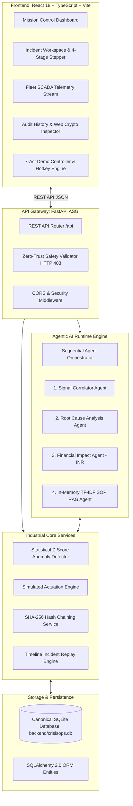
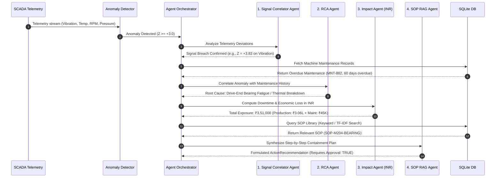
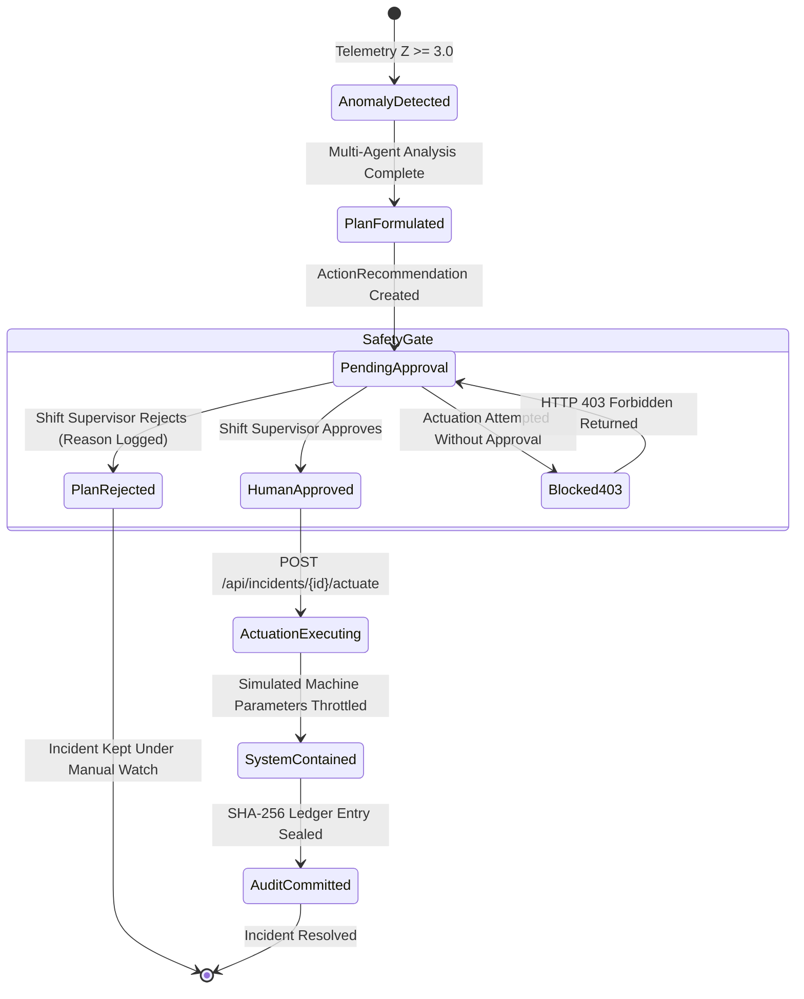
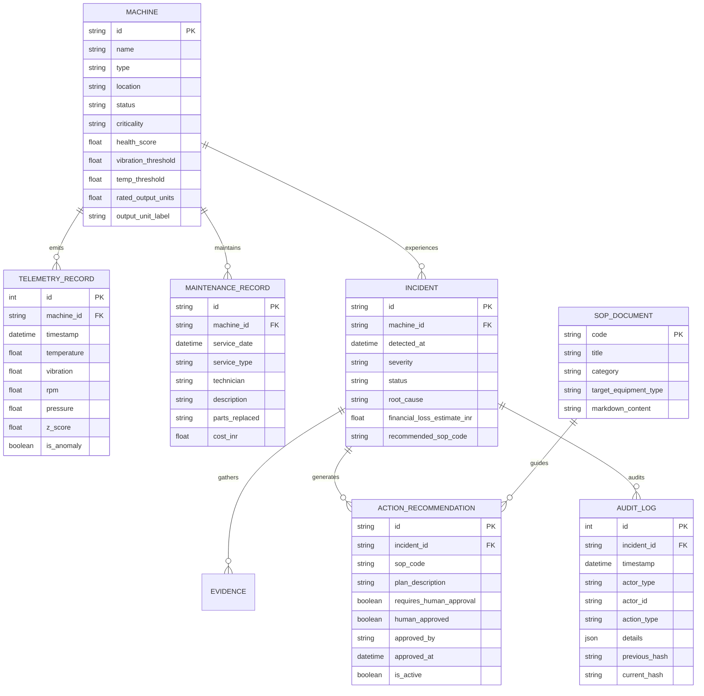

# Industrial CrisisOps — System Architecture Specification

## 1. Executive System Overview

Industrial CrisisOps is an agentic AI operations platform designed for rapid incident investigation, root-cause correlation, and policy-controlled autonomous recovery in industrial manufacturing facilities.

The platform is designed around three non-negotiable industrial constraints:
1. **Explainable, Deterministic Agent Reasoning**: No black-box generative hallucinations during active emergencies. Every diagnostic conclusion is grounded in verifiable sensor telemetry and equipment maintenance records.
2. **Zero-Trust Safety & Human Authorization**: Autonomous AI systems are prohibited from directly modifying industrial machinery parameters. All containment actuation requires explicit human operator sign-off, enforced at the API layer with HTTP 403 guards.
3. **Cryptographic Tamper-Evidence**: Incident events, operator approvals, and actuation commands are recorded in an append-only SHA-256 hash-chained ledger, verifiable client-side via the browser-native Web Crypto API.

---

## 2. High-Level Architecture Diagram



---

## 3. The 4-Stage Multi-Agent Pipeline

The incident investigation pipeline processes raw telemetry breaches through four sequential, deterministic agent stages:



### 1. Signal Correlator Agent (`backend/app/agents/signal_agent.py`)
- Evaluates multi-channel sensor telemetry against rolling baseline statistics ($\mu, \sigma$).
- Calculates standardized Z-scores:
  $$Z = \frac{X_t - \mu}{\sigma}$$
- Pinpoints the primary anomaly metric (e.g., Drive-end vibration jumping to $7.82\text{ mm/s}$ vs baseline $1.80\text{ mm/s}$).

### 2. Root Cause Analysis (RCA) Agent (`backend/app/agents/rca_agent.py`)
- Queries the maintenance ledger for the target machine (`MaintenanceRecord`).
- Compares operational running hours since last service against recommended overhaul intervals.
- Correlates mechanical symptoms with maintenance status (e.g., identifies that bearing replacement `MNT-882` is 60 days overdue).

### 3. Financial Impact Agent (`backend/app/agents/impact_agent.py`)
- Calculates downtime losses, capacity reductions, and repair costs denominated in Indian Rupees (₹ INR).
- Deterministic formula:
  $$\text{Production Lost} = \text{Rated Output (units/hr)} \times \text{Capacity Drop \%} \times \text{Repair Hours}$$
  $$\text{Production Loss (₹)} = \text{Production Lost} \times \text{Unit Finished Value (₹)}$$
  $$\text{Maintenance Cost (₹)} = \text{Replacement Parts (₹)} + (\text{Labor Hours} \times \text{Hourly Rate (₹)})$$
  $$\text{Total Exposure (₹)} = \text{Production Loss} + \text{Maintenance Cost}$$

### 4. SOP Retrieval Agent (`backend/app/agents/sop_agent.py`)
- Executes in-memory keyword matching and TF-IDF term scoring against registered plant procedures (`SOPDocument`).
- Extracts precise containment steps, safety precautions, required PPE, and verification criteria.
- Formulates an actionable `ActionRecommendation` locked behind operator authorization.

---

## 4. Zero-Trust Safety & Human-in-the-Loop Architecture

In industrial systems, unintended physical actuation can result in catastrophic equipment destruction or worker injury. CrisisOps implements a zero-trust safety model:



### Safety Invariants
1. **Server-Side Enforcement**: The actuation gate in `backend/app/services/actuation_engine.py` executes a database query verifying that `ActionRecommendation.human_approved == True` before dispatching any command.
2. **Non-Bypassable HTTP 403**: Direct API invocations of `/api/incidents/{id}/actuate` without an approved recommendation fail immediately with HTTP 403 Forbidden.
3. **Actor Accountability**: Every approval or rejection requires the operator's name, role (e.g., "Shift Supervisor Deshmukh"), and justification, permanently bound to the record.

---

## 5. Cryptographic SHA-256 Audit Chaining

All significant system transitions are logged to an append-only ledger governed by `backend/app/services/audit_service.py`.

### Mathematical Chaining Function
For transaction $n$, the current hash $H_n$ is computed as:

$$H_n = \text{SHA256}\left( \text{id}_n \parallel \text{timestamp}_n \parallel \text{actor\_type}_n \parallel \text{actor\_id}_n \parallel \text{action\_type}_n \parallel \text{details\_json}_n \parallel H_{n-1} \right)$$

- Genesis Hash $H_0 = \text{"0" \times 64}$.
- **Immutable Ledger**: Any alteration to record $k$ invalidates all subsequent hashes $H_{k}, H_{k+1}, \dots, H_n$.
- **Web Crypto Verification**: The client application uses `window.crypto.subtle.digest('SHA-256', ...)` to independently recalculate the chain and verify integrity with zero reliance on backend assertions.

---

## 6. Entity Relationship & Data Model



---

## 7. Deterministic Database & Test Isolation

To eliminate working-directory path resolution bugs, CrisisOps anchors its SQLite database path to the backend module root:

```python
# backend/app/core/config.py
BACKEND_DIR = Path(__file__).resolve().parent.parent.parent
CANONICAL_DB_PATH = BACKEND_DIR / "crisisops.db"

@property
def resolved_database_url(self) -> str:
    if self.DATABASE_URL.startswith("sqlite:///./"):
        return f"sqlite:///{CANONICAL_DB_PATH.as_posix()}"
    return self.DATABASE_URL
```

- **Production / Dev DB**: Anchored deterministically to `backend/crisisops.db`.
- **Test DB**: Pytest automatically routes transactions to `backend/tests/test_crisisops.db` and drops it on fixture teardown (`backend/tests/conftest.py`). The production database is never polluted by test executions.

---

## 8. Deployment Architecture (Render)

CrisisOps is configured for automated continuous deployment using Render infrastructure (`render.yaml`):

| Component | Service Type | Runtime | Root Dir | Build Command | Start Command / Static Path |
| :--- | :--- | :--- | :--- | :--- | :--- |
| **Backend API** | Web Service | Python 3.10+ | `backend` | `pip install -r requirements.txt` | `uvicorn app.main:app --host 0.0.0.0 --port $PORT` |
| **Frontend UI** | Static Site | Node.js | `frontend` | `npm ci && npm run build` | `./dist` (Rewrite `/*` to `/index.html`) |

- **CORS Handling**: Backend pre-authorizes `https://crisisops.onrender.com` and `http://localhost:5173`.
- **Health Check**: Render monitors `GET /api/health` for zero-downtime health verification.
