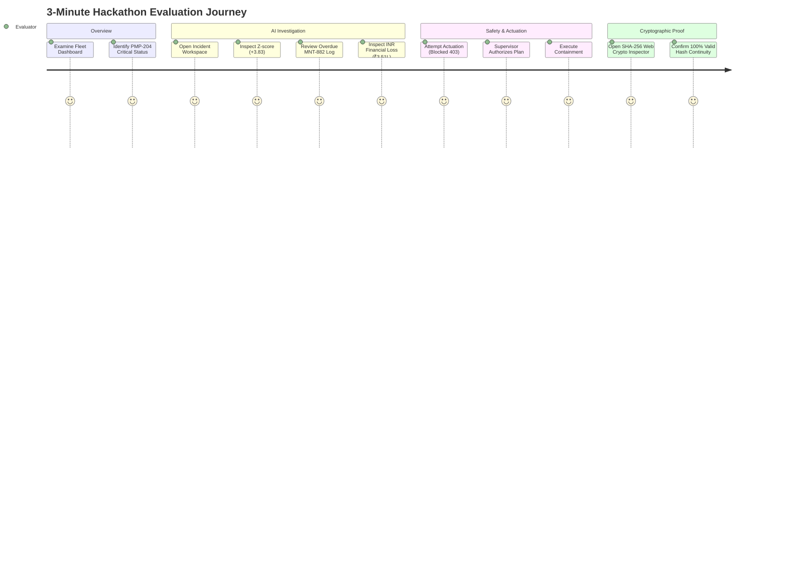

# Industrial CrisisOps — Evaluator & Hackathon Demo Guide

## 1. Executive Summary

This guide provides an evaluator or judge with a step-by-step script to experience and verify Industrial CrisisOps in **3 to 5 minutes**.

### Demonstration Objectives
1. **Understand Operational Purpose in 30 Seconds**: Clear plant overview showing equipment status, critical warnings, and next actions.
2. **Witness Autonomous Agent Investigation**: Follow the 4-stage pipeline translating a raw sensor spike into a root cause and an actionable containment plan.
3. **Verify Zero-Trust Safety (HITL)**: Confirm that unapproved autonomous actuation is strictly blocked at the API layer with HTTP 403 Forbidden.
4. **Inspect Indian Rupee Financial Impact**: Review line-item financial risk modeling customized for automotive manufacturing plants.
5. **Inspect Cryptographic Proof**: Recalculate SHA-256 hash chains client-side via the browser Web Crypto API.

---

## 2. Industrial Plant Context

- **Facility**: Automotive Powertrain & Machining Facility
- **Location**: Chakan MIDC, Pune, Maharashtra, India
- **Monitored Fleet**: 10 heavy industrial assets (Centrifugal Pumps, 5-Axis CNC Mills, Turning Lathes, Gas Compressors, Welding Robots).
- **Primary Scenario Incident**: `INC-M204-001` — Critical bearing overheating and harmonic vibration runaway on primary coolant pump `PMP-204` (`M-204`).

---

## 3. Quick-Start Setup

Ensure both backend and frontend are running:

```bash
# Terminal 1: Backend API
cd backend
.\venv\Scripts\Activate.ps1
uvicorn app.main:app --host 127.0.0.1 --port 8000 --reload

# Terminal 2: Frontend UI
cd frontend
npm run dev
```

Open your browser to: **`http://localhost:5173`** (or the production demo: [https://crisisops.onrender.com](https://crisisops.onrender.com)).

---

## 4. Keyboard Shortcuts & Demo Controller

Press **`?`** on any page or click **"Demo Guide"** in the top navigation bar to summon the interactive 7-Act Demo Controller.

| Hotkey | Scene | Action / Screen |
| :---: | :--- | :--- |
| **`?`** | Help | Toggle Demo Guide Modal & Hotkey Overlay |
| **`1`** | **Act 1: Normal Operations** | Displays normal baseline fleet status across all 10 assets |
| **`2`** | **Act 2: Anomaly Spike** | Injects high-vibration bearing breach into pump `PMP-204` |
| **`3`** | **Act 3: Statistical Signal** | Opens Incident Workspace to inspect Z-score deviation |
| **`4`** | **Act 4: AI 4-Agent Pipeline** | Runs Signal $\to$ RCA $\to$ Impact (INR) $\to$ SOP retrieval |
| **`5`** | **Act 5: Safety Gate** | Demonstrates HTTP 403 lock & operator approval control |
| **`6`** | **Act 6: Actuation** | Executes containment, throttling pump and stabilizing stream |
| **`7`** | **Act 7: Hash Verifier** | Launches browser Web Crypto SHA-256 ledger inspector |

---

## 5. Detailed 7-Act Evaluator Walkthrough



### Act 1: Plant Overview (Press `1` or Navigate to Dashboard)
- **What you see**: High-level operational summary cards showing Active Incidents (1 Critical), Fleet Health (81%), and 10 assets.
- **Key Observation**: PMP-204 Centrifugal Coolant Pump is highlighted in red `CRITICAL` status due to a vibration spike ($7.82\text{ mm/s}$ vs $4.50\text{ mm/s}$ safety threshold).
- **Screenshot Reference**:
  

---

### Act 2: Live SCADA Telemetry (Press `2` or Navigate to Live SCADA)
- **What you see**: Real-time sensor stream showing temperature, vibration, and RPM dials.
- **Key Observation**: Notice the clear threshold reference markers:
  - Vibration: **$7.82\text{ mm/s}$** (Alarm Threshold: $4.50\text{ mm/s}$)
  - Bearing Temp: **$88.5^\circ\text{C}$** (Trip Threshold: $75.0^\circ\text{C}$)
- **Screenshot Reference**:
  

---

### Act 3: Incident Investigation Workspace (Press `3` or Click Incidents)
- **What you see**: Incident record `INC-M204-001`. Click on it to open the deep investigation view.
- **Key Observation**: The top banner clearly highlights:
  - *What happened*: Drive-end bearing thermal runaway.
  - *Why it matters*: Risk of total spindle seizure across Machining Line B.
  - *Next action*: Operator review of AI containment recommendation.
- **Screenshot Reference**:
  

---

### Act 4: The 4-Stage AI Pipeline (Press `4`)
Inspect the 4 diagnostic cards generated by the autonomous agent orchestrator:

1. **Stage 1 (Signal Correlator)**:
   - Evaluates baseline statistics ($\mu = 1.80\text{ mm/s}, \sigma = 1.567$).
   - Flags critical anomaly at $Z = +3.83$.
2. **Stage 2 (Root Cause Analysis)**:
   - Correlates with maintenance record `MNT-882` (Bearing overhaul).
   - Notes bearing replacement was scheduled for 60 days ago but never completed.
3. **Stage 3 (Financial Impact Assessment — INR)**:
   - Computes production loss: $504\text{ m}^3$ coolant disruption $\to$ **₹3,06,000 (₹3.06 Lakh)**.
   - Emergency OEM replacement kit & labor: **₹45,000**.
   - Total estimated plant financial exposure: **₹3,51,000 (₹3.51 Lakh)**.
4. **Stage 4 (SOP Retrieval Engine)**:
   - Matches procedure `SOP-M204-BEARING`.
   - Recommends throttling hydraulic motor to 25% capacity and spinning up standby pump PMP-102.

---

### Act 5: Zero-Trust Safety Gate (Press `5`)
- **Interactive Test — Attempt Actuation Without Approval**:
  - The UI disables the "Execute Actuation" button until human approval is signed.
  - If triggered directly via API (`curl -X POST http://localhost:8000/api/incidents/INC-M204-001/execute-actuation`), the backend strictly returns **`HTTP 403 Forbidden`**.
- **Grant Human Approval**:
  - Click **"Approve Containment Plan"**.
  - Enter operator name (e.g., `Shift Supervisor Deshmukh`).
  - System logs an authorized approval event.

---

### Act 6: Containment Execution (Press `6`)
- Click **"Execute Containment Actuation"**.
- **What happens**:
  - Pump load throttled to 25% capacity.
  - Secondary standby pump PMP-102 engaged.
  - Machine status transitions from `CRITICAL` $\to$ **`CONTAINED`**.
  - Telemetry stabilizes back inside nominal operating envelopes ($1.80\text{ mm/s}, 65.0^\circ\text{C}$).

---

### Act 7: Cryptographic Proof & SHA-256 Inspector (Press `7`)
- Click **"Inspect Cryptographic Audit Ledger"** (or open **Audit History** from the left navigation bar).
- **What you see**:
  - A chronological ledger showing: `INCIDENT_CREATED` $\to$ `RECOMMENDATION_FORMULATED` $\to$ `HUMAN_APPROVAL` $\to$ `ACTUATION_EXECUTED`.
  - Every entry displays its `Previous Hash`, `Event Data`, and `Current Hash`.
  - Click **"Verify Hash Continuity"**.
  - The browser executes `crypto.subtle.digest('SHA-256')` across each entry, displaying green confirmation badges proving 0 entries were tampered with.
- **Screenshot Reference**:
  

---

## 6. Evaluation Verification Checklist

| # | Checkpoint | How to Verify | Expected Outcome |
| :---: | :--- | :--- | :--- |
| 1 | **Fast First-Time Comprehension** | Look at Dashboard in first 10 seconds | Target asset (`PMP-204`) and severity are instantly visible |
| 2 | **Statistical Grounding** | Inspect Incident Stage 1 Card | Shows exact $Z = +3.83$ calculation with baseline $\mu$ and $\sigma$ |
| 3 | **Domain Accuracy** | Review Root Cause Card | References actual maintenance record `MNT-882` and 60 days overdue |
| 4 | **Indian Rupee Currency** | Inspect Impact Card | Values displayed in ₹ Lakhs (Total: ₹3,51,000) with line items |
| 5 | **Safety Invariant (HTTP 403)** | Review `actuation_engine.py` or trigger API without approval | Actuation is physically impossible without human authorization |
| 6 | **Tamper-Evident Ledger** | Open Audit History and click Verify | Client-side Web Crypto confirms 100% valid hash chain |
| 7 | **Production Build** | Run `npm run build` | Zero TypeScript/Vite bundle compilation warnings or errors |
| 8 | **Automated Tests** | Run `pytest backend/tests -v` | All 41 automated tests pass cleanly |
